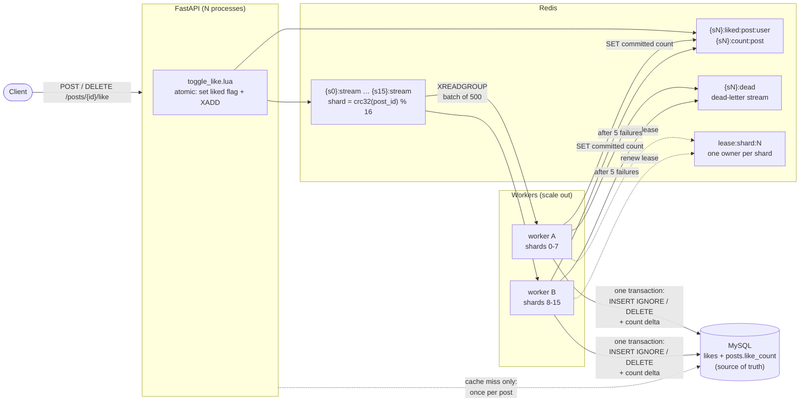

# Scalable Likes System


A like/unlike service built to handle the traffic of a viral post: **FastAPI + Redis
Streams + sharded, lease-based workers + MySQL**. The API never touches MySQL per
user. Likes are queued in Redis and written to MySQL in batches, in order, and safely
retried, by workers that survive crashes, MySQL outages and bad messages.

**6,116 req/s end to end, p99 151 ms, zero errors**: 183,746 like/unlike requests in
30 s from 500 concurrent connections on a laptop (i7-11600H). Workers kept up, and the
queue was empty afterwards. Even on a **single CPU core** the full system does 505 req/s.
Details in [About the numbers](#about-the-numbers).

## Architecture



1. **Write path**: one Lua script sets the user's liked flag and appends the event to
   the post's shard stream as one atomic step. If the user already likes the post, nothing is queued.
2. **Ordering**: each shard is owned by exactly one worker at a time (Redis lease,
   30 s TTL), so events for a post are always applied in the order they arrived.
3. **Durability**: messages are acknowledged only after the MySQL commit. A crashed
   worker's unacknowledged messages are processed first by the next owner.
4. **Idempotency**: counts change by the number of rows actually inserted or deleted, so replaying a
   batch changes nothing.
5. **Cache**: the worker writes the exact committed count back to Redis. The user's
   own liked state updates instantly, while the displayed count lags by about one batch (~1 s).

## Features

- Sharded Redis Streams with consumer groups, using `{sN}` hash tags so it's ready for Redis Cluster
- Lease-based shard ownership with automatic rebalancing when workers join or leave
- Batched, ordered, deadlock-free MySQL writes (post rows are locked in sorted order)
- Poison messages are isolated and moved to a dead-letter stream after 5 attempts
- The API keeps accepting likes during a MySQL outage, and the backlog drains when MySQL returns
- Single-flight cache loading, and `503 + Retry-After` instead of 500 when overloaded
- Scripts for load testing, correctness checks, reconciliation and reset

## Project layout

```
app/
  main.py                 FastAPI app
  config.py               all settings (NUM_SHARDS must match API and worker)
  sharding.py             shard_of(post_id) and key names
  lua/toggle_like.lua     atomic: update cache + append to queue
  routers/likes.py        POST/DELETE /posts/{id}/like, GET /posts/{id}/likes
  dao/like_cache_dao.py   Redis side: toggle script, cache loading
  dao/like_dao.py         MySQL side: reads + batch writer
  models/like.py          event + response models
  validators/like_validator.py
worker/worker.py          shard leases, consumer loop, poison handling, trimming
scripts/                  loadtest, verify, reconcile, reset
sql/schema.sql            posts (100 seeded) + likes
```

## Run

Requires **Redis 7.0+** (the worker needs 6.2+ for `XTRIM MINID`, the verify
script needs 7.0+ for the backlog check). Ubuntu 22.04's `apt` Redis is 6.0,
so use the one from docker-compose. Check with `redis-cli -p 6380 INFO server`.

```bash
docker compose up -d                      # MySQL on 3307, Redis on 6380
python -m venv .venv && source .venv/bin/activate
pip install -r requirements.txt

# terminal 1
uvicorn app.main:app --port 8000 --workers 4
# terminal 2
python -m worker.worker
```

Try it:

```bash
curl -X POST   localhost:8000/posts/1/like  -H 'X-User-Id: 42'
curl -X POST   localhost:8000/posts/1/like  -H 'X-User-Id: 42'   # queued:false (no-op)
curl           localhost:8000/posts/1/likes -H 'X-User-Id: 42'
curl -X DELETE localhost:8000/posts/1/like  -H 'X-User-Id: 42'
```

## Tests to run

Run `python -m scripts.verify` after each one. It waits for the queue to drain,
then checks MySQL counts vs rows, Redis vs MySQL, and liked flags. It must print PASS.
`python -m scripts.reset` (with workers stopped) starts you fresh.

1. **Load**: `python -m scripts.loadtest --requests 20000 --concurrency 200`
   70% of traffic hits 3 "viral" posts.
2. **Worker crash**: start a load test, `kill -9` the worker midway, start a new
   one. It takes over within ~30s (lease expiry) and processes the dead worker's
   unacknowledged messages first.
3. **MySQL outage**: run a load test once to warm the cache, then
   `docker compose stop mysql` and run it again with the same small user range
   (`--users 50 --posts 3 --hot-ratio 1`). The API keeps returning 200, the
   worker logs "temporary error", the backlog grows. `docker compose start mysql`
   and the backlog drains. Cache misses do fail while MySQL is down: the cache
   can only be loaded from MySQL.
4. **Poison message**: inject a malformed event:
   ```bash
   S=$(python -c "from app.sharding import shard_of; print(shard_of(1))")
   docker compose exec redis redis-cli xadd "{s$S}:stream" '*' user_id abc post_id 1 action like ts 1
   ```
   After 5 attempts it moves to `{sN}:dead` and the shard keeps flowing.
5. **Scale out**: start a second worker. Within ~20s each owns half the shards.
6. **Reconcile**: `python -m scripts.reconcile` fixes drifted MySQL counts and
   drops cached counts that disagree with MySQL (e.g. after Redis restored an old
   snapshot). Run it with the queue drained.
7. **Graceful stop**: Ctrl+C on a worker logs "stopped cleanly" within a second
   or two and releases its leases, so another worker takes over immediately.

## About the numbers

### Laptop (6 cores / 12 threads)

Intel i7-11600H, 16 GB RAM. The API runs as `uvicorn --workers 10` with 3 queue
workers, Redis 8.x and MySQL 8, all on the same machine as `wrk`.

```bash
wrk -t3 -c500 -d30s --latency -s wrk_likes.lua http://127.0.0.1:8000
```

| Requests/sec | p50 | p75 | p90 | p99 | Errors |
|---|---|---|---|---|---|
| **6,116** | 80 ms | 90 ms | 113 ms | 151 ms | 0 |

That is 183,746 requests in 30 s, with 70% of traffic on 3 "viral" posts and 30% unlikes.
Afterwards the streams had 0 pending messages, so MySQL writes kept pace with the API.

### Single CPU core

Measured with `wrk` (a C load tool; the Python load script uses too much CPU to
measure with) on a 1-CPU sandbox, 200 connections, cold cache, 30 s:

| | Before fix | After fix |
|---|---|---|
| API alone (worker stopped) | 695 req/s, p50 348 ms | 1,351 req/s, p50 138 ms |
| Full system (API + worker) | 312 req/s | 505 req/s |

Before the fix, a user's first like on a post read MySQL twice, and most likes
are first likes. After it, the API never reads MySQL per user, and concurrent
cache misses for one post share a single query (single-flight), which took the
cold-start p99 from 4.0 s to 0.76 s.

Past capacity, requests wait up to 5 s for a Redis connection, then get
**503 "busy, retry shortly"** with `Retry-After: 1` rather than a 500. Adding
concurrency beyond saturation only lengthens the wait; it never adds throughput.

`scripts/loadtest.py` itself tops out around 170–250 req/s (Python HTTP client), so
use `wrk` for throughput numbers and keep the Python script for correctness runs.

On one CPU the worker competes with the API for the same core, which is why the
full-system number is lower and its p99 is still ~3 s. On a multi-core machine
they run in parallel. To test with wrk, see `wrk_likes.lua`:

```bash
wrk -t2 -c200 -d30s --latency -s wrk_likes.lua http://127.0.0.1:8000
```

## Not covered locally

- Redis Cluster: runs on one Redis node, but keys already carry `{sN}` hash tags,
  so moving to a cluster needs no key changes.
- Changing `NUM_SHARDS` remaps posts to other streams; only do it with streams drained.
